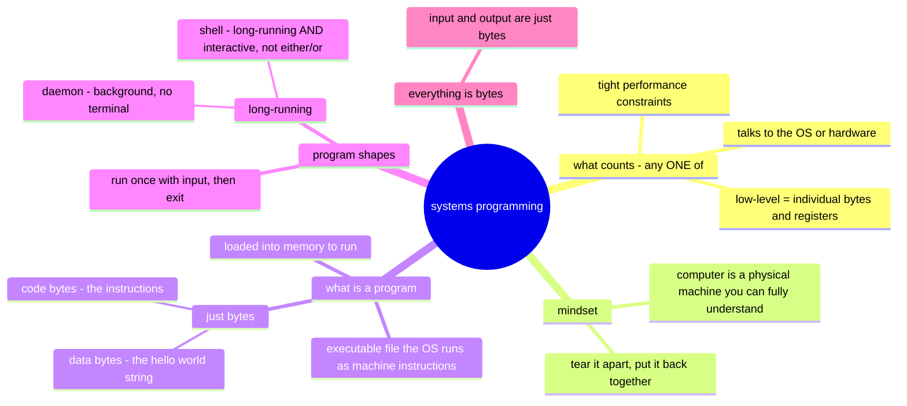

# Systems programming & what a program is (eblog pt 1, ch 1–3)

Session S2 · Source: https://eblog.fly.dev/startingsystems1.html · Notes: `notes/os/eblog-programs.md`

**One-line takeaway:** a program is just bytes — some are code, some are data — and a systems programmer is someone who isn't afraid to look at them directly.
