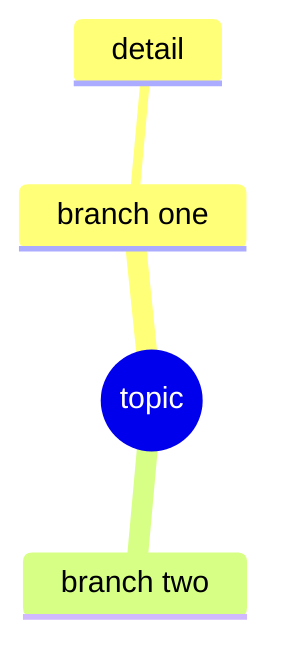

# <Chapter/Topic name>

Source: <book + chapter / lecture / article link>
Date: <yyyy-mm-dd>

## Questions (jot the moment they occur — don't stop to research)

Having questions = reading actively. No questions is the suspicious outcome.

-

## Mind map (my summary — built from memory after reading)

(Or draw on paper and share a photo in the session. A few fallback bullets are fine too.)

## Claude's gap-check notes (missing branches, wrong arrows — filled during ritual)

-

Refined diagram: `diagrams/<topic>.md`
