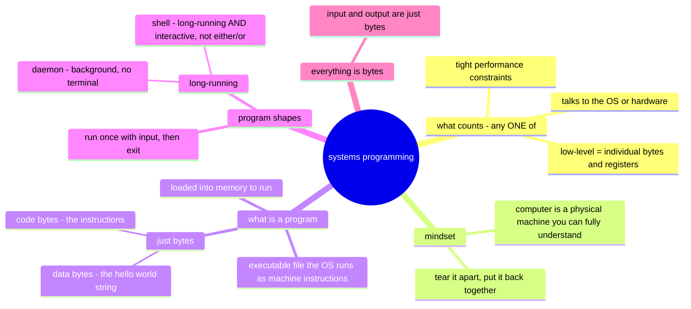

# Starting Systems Programming, pt 1 — Programmers Write Programs

Source: https://eblog.fly.dev/startingsystems1.html (ch 1–3 in S2, ch 4–5 in S3)
Date: July 16 2026

## Questions (jot the moment they occur — don't stop to research)

Having questions = reading actively. No questions is the suspicious outcome.

- ~~Don't ALL programs deal with individual bytes/registers?~~ **Answered (S2):** every program *runs* as bytes+registers, but "dealing with" = the level you program at. App code: libraries hide the layout (`json.Marshal`). Systems code: the byte layout IS your interface (e.g. gokv's log record format — endianness, length prefixes, torn writes). Litmus test: if the byte layout could change without your code changing, it's not systems programming. Refined (after classify drill): app code *consumes* abstractions (json.Marshal, Go map), systems code *builds* them or reaches beneath. The trait attaches to the CODE, not the project — gokv v0 (map+REPL) is application code; it becomes systems code when concurrency (S24) and my own disk format (S32) arrive.

## Mind map (my summary — built from memory after reading)

My original prose summary (S2, kept for reference):

> Chapter 1-3 talk about what is systems programming. Its when a program that talks to both hardware and os. Its when a program is low-level (but we don't know what low-level means yet). Its when the program has performance constraints.
> Then we go back to basics and talk about what a program is, what is in a program, different types of programs (programs that take input vs programs that constantly run).
> And when the author talks about input, output. They mean bytes.

## Claude's gap-check notes (missing branches, wrong arrows — filled during ritual)

- The three systems-programming traits are alternatives (OR), not requirements (AND) — a program qualifies via any one
- "Low-level" IS defined in ch 2: dealing with individual bytes or registers
- Missing branch: the mindset — computer as a fully understandable physical machine; "unafraid to tear something apart, confident they can put it back together"
- Q3 refinement: daemon = background + detached from terminal; a shell is long-running *interactive* — "takes input" vs "runs forever" is not a dichotomy

Refined diagram: `diagrams/eblog-programs.md`
