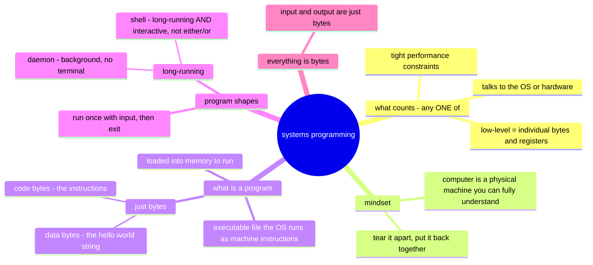

# Starting Systems Programming, pt 1 — Programmers Write Programs

Source: https://eblog.fly.dev/startingsystems1.html (ch 1–3 in S2; §4.5–4.7 + data/code
segment investigations + §5.1 `shexdump` in S3)
Date: July 16 2026 (S2), Sep 9 2026 (S3)

## Questions (jot the moment they occur — don't stop to research)

Having questions = reading actively. No questions is the suspicious outcome.

- ~~Don't ALL programs deal with individual bytes/registers?~~ **Answered (S2):** every program _runs_ as bytes+registers, but "dealing with" = the level you program at. App code: libraries hide the layout (`json.Marshal`). Systems code: the byte layout IS your interface (e.g. gokv's log record format — endianness, length prefixes, torn writes). Litmus test: if the byte layout could change without your code changing, it's not systems programming. Refined (after classify drill): app code _consumes_ abstractions (json.Marshal, Go map), systems code _builds_ them or reaches beneath. The trait attaches to the CODE, not the project — gokv v0 (map+REPL) is application code; it becomes systems code when concurrency (S24) and my own disk format (S32) arrive.

    **The example that made it click (LRU cache → buffer pool):** a leetcode LRU (Go map + container/list, capacity in items) is application code — memory is the GC's problem. The systems version: capacity is a byte budget (say 64MB), entries are fixed-size pages in an array I allocated, eviction picks a victim, dirty pages get written back to disk before dropping (clean ones just forgotten).

    > "So the full picture of your buffer-pool-to-be: your own page array (memory layout: yours) + byte budget accounting (yours) + LRU eviction choosing a victim (yours) + dirty-tracking and write-back through the OS (yours). Every decision the application version outsourced, you've insourced. That's what makes it a systems program."

    This same structure appears twice ahead: OS page replacement (S16) and godb's buffer pool (M6).

### S3 (ch 4–5)

- ~~Patched `hackedhello` with binpatch.go, but running it → `[1] killed` / exit 137.~~
  **Answered (S3): macOS code-signing, not a bad patch.** exit 137 = 128 + signal 9
  (SIGKILL). On Apple Silicon (arm64) code signing is *mandatory*: a Mach-O carries a
  signature (`LC_CODE_SIGNATURE` → `__LINKEDIT`) holding a hash of every executable page.
  Patching bytes invalidates those hashes; at exec the kernel (AMFI) re-checks pages vs the
  signature, mismatches, and SIGKILLs. The eblog assumes Linux/ELF, which has no such check.
  Fix on macOS: re-sign ad-hoc after patching → `codesign -f -s - hackedhello`. Verified:
  before = exit 137, after = prints the patched string, exit 0. **The patch was correct all
  along** — macOS just needs the binary re-blessed. New workflow here: patch → re-sign → run.

- ~~If I can just add an ad-hoc signature and make it run, what is the signature even for?~~
  **Answered (S3):** the signature does two jobs; ad-hoc restores only one.
  (1) **Integrity** — "running code == signed bytes" (the page-hash check). Ad-hoc gives you
  this. (2) **Authenticity** — *who* signed it (Apple / a Developer ID cert). Ad-hoc = signed
  by *nobody*, anonymous. So re-signing doesn't defeat the system; it downgrades the binary
  from "authentically vendor X" to "anonymous but tamper-checked." Why integrity-without-
  identity still matters: malware can't *silently* patch a trusted app (the seal breaks →
  kernel kills it → tampering is loud); and permissions/entitlements (TCC camera/mic/disk,
  keychain) are bound to the signing identity, so a patched binary is a *different* identity
  and inherits none of the original's trust. The trust-from-the-internet decision is a
  *separate* layer — Gatekeeper + notarization — which only applies to quarantined
  (downloaded) files; my locally-built binary skips it, which is why ad-hoc runs. **The
  principle:** the model doesn't make bytes unchangeable — it makes change inseparable from
  *identity* change. You can modify anything; you just can't modify it and keep the
  original's name, trust, and permissions.

- ~~`./findoffset hello "hello, world"` → 645538. Why does a simple hello world have so
  many bytes?~~ **Answered (S3):** 645538 is the *offset* of the string, not the size — the
  binary is actually **2.3 MB**. It's a Go binary; `size -m` breakdown:
  `__text` code ~637 KB (the whole Go runtime — GC, scheduler, allocator — plus `fmt`,
  statically linked; `strings` finds 2106 `runtime.` refs) + `__gopclntab` ~487 KB
  (PC→source-line table, powers readable panics and precise GC stack-walking) + `__DWARF`
  ~636 KB (unstripped debug symbols) + `__rodata`/type/itab ~320 KB (reflection metadata
  `fmt` needs) + data/bss/linkedit ~370 KB. The actual `"hello, world"` string = **12
  bytes**. Three causes: (1) Go statically links everything — a *dynamically*-linked C
  hello world is ~20–50 KB because `printf` lives in `libc.so`, loaded at runtime not
  copied in; Go trades size for a self-contained zero-dependency binary. (2) ~487 KB is
  pclntab metadata. (3) ~636 KB is strippable DWARF — `go build -ldflags="-s -w"` roughly
  halves the file. Ties to S2 "code bytes vs data bytes": data = 12 bytes, the other
  99.999% is code + metadata to run and *describe* it. Offset 645538 lands in `__rodata`,
  just past the code — where read-only string constants belong.

### S3 (ch 4–7: reaching into files; data & code segments)

- ~~Dumping the binary with `torso` shows a wall of mashed-together words
  (`...multipathtcprandautoseed...hello, world!3814697265625wakeable...`). Why?~~
  **Answered (4.7): the string blob.** Go packs *all* string constants — from your code
  and every stdlib package linked in — end-to-end into one contiguous `__rodata` region,
  **no separators**. A Go `string` is just a `(pointer, length)` into this blob; the length
  bounds it, there's no `\0` terminator or gap. So a dump reads across dozens of unrelated
  strings (stdlib error messages, type names, my literal) sitting adjacent. *This is the
  same `__rodata` from the "why is hello world 2.3 MB" question.* The messy dump IS the
  lesson: strings aren't tidy separate objects, they're offsets into one packed arena.

- ~~What's the number `3814697265625` doing in a hello-world binary?~~ **Answered (4.7):**
  it's **5¹⁸**, an entry in a lookup table in `strconv/decimal.go` (Ken Thompson's code) for
  converting floats to decimal correctly. The trick: scaling by `10ⁿ` = scaling by `2ⁿ·5ⁿ`;
  the `2ⁿ` half is a free bit-shift, so they precompute the awkward `5ⁿ` half as decimal
  digit strings (leading digits of `1/2ⁿ` = digits of `5ⁿ`). The `// * 262144` comment I saw
  = `2¹⁸`, paired with `5¹⁸`. It's in my binary because `fmt`→`strconv` is statically linked.
  Author flags it "revisit later" — not expected to fully get the float math now; the
  takeaway is the string-blob point above.

- ~~Why convert bytes to hex for viewing (`shexdump`)? Why not decimal?~~ **Answered (5.1):**
  because 16 = 2⁴, so hex is *structurally aligned* to bytes and bits at once: 1 byte = exactly
  2 hex digits (`00`–`FF`) → fixed-width columns you can align and scan; and 1 hex digit = exactly
  4 bits (a nibble) → you read the bit pattern straight off (`F0` = `1111 0000`). Decimal fails
  both: a byte is 1–3 decimal digits (ragged columns), and base 10 has no relation to powers of
  2 (digits smear across bit boundaries — `240` hides what `F0` shows). Offsets/addresses/magic
  numbers are hex too (`0x1000`=4096, ELF magic `7F 45 4C 46`), so everything speaks one base.
  It's purely a **display** choice — the bytes are identical; hex is just the notation a human
  can read bits and boundaries in. See [[bytes-and-numbers]] for the shift/serialization thread,
  and [[text-encoding-unicode-utf8]] for the big follow-on thread (Unicode vs UTF-8 vs fonts,
  decoding `café`/`é` to code points, Python-vs-Go in-memory text, byte-level string comparison).

#### Exercise: torso → lines (`4.6torsolines.go`)

Modified `torso` to read by *lines* via a `-lines` flag. Design decisions and gotchas:
- **Mode detection via sentinel:** flags default to `-1` (= "not provided", same trick as the
  original's `offset < 0`). Derived one bool `readbybytes` from `lines < 0` up front, then
  branch on it — don't re-check sentinels everywhere, and don't expose the mode as its own
  flag (would let a user contradict `-lines`).
- **Decide mode *first*, then validate within the mode** — byte-mode clamping (`min(before,
  offset)`) is meaningless in lines mode. Wrong order was my first bug.
- **`bufio.NewReader` + `ReadBytes('\n')`** for the forward line read — counting lines
  directly, so "how many bytes is N lines" never has to be computed.
- **The `ReadBytes`/EOF gotcha (took 3 tries):** `ReadBytes` returns the data read **and** the
  error *together* — at EOF on a file whose last line has no trailing `\n`, it returns
  `("lastline", io.EOF)`. So the EOF branch must **append the line THEN stop**, not return
  early (drops the last line) and not keep looping (spins on empty reads). Also: EOF is
  *success-ish* (return what you have) vs a real error (bail loudly) — they need different
  outcomes, not a shared `return nil`. Tested with `printf 'a\nb'` (no trailing newline).
- **Scope:** built forward-only (N lines from offset). The full "torso" (before/after window
  *in lines*) needs a **backward** read — reasoned through Strategy A (seek+read blocks that
  END at the cursor, scan right→left counting `\n`, `start` = one past the Nth newline back,
  clamp at 0) but did not implement. Key reframe: *don't read backward line-by-line — find the
  `start` byte, then reuse the forward reader.* Backward cost = size of the before-window (bytes
  you'd read anyway); still beats reading from byte 0 every time. If it were a hot path you'd
  build a **line index** (byte offset per line) and binary-search — i.e. a database index. That
  linear-scan-vs-index tension is the exact motivation for DB indexes, seen in a file tool.

### S3 (§5.4: binary structure, instruction pointer, endianness)

Worked §5.4 because my Mach-O header output differed from the blog's ELF. Covered: executable
formats (ELF/Mach-O/PE; format = OS, arch = a header field), load commands vs `__TEXT`, static
vs dynamic linking (`fmt` baked in vs `libSystem` loaded by `dyld`), the instruction pointer
(fetch→execute→advance; ARM64 +4 fixed vs x86-64 variable; CALL/RET via return address on the
stack), and endianness (a CPU-arch property; little vs big; and why the on-disk format must pin
one order for cross-arch backup/restore). My own-words recap, gap-checked:
[[binary-formats-my-summary]].

## Closing takeaway — what systems programming is (my words, refined)

Systems programming = **you own the layer where bytes are the interface; you *build* the
abstraction instead of consuming one.** The litmus (S2): if the byte layout could change without
your code changing, it's not systems programming.

For a database that shows up as three sibling activities:
1. **Design your own data format** — decide how records are laid out, then write bytes directly
   to memory/disk in that format. On the way back, know where to seek, read only the structural
   bytes you need (length prefixes, headers, offsets) to locate the record, and decode/parse
   *only as much as needed* — the value payload often stays **opaque bytes** handed back to the
   caller, never decoded (gokv's model).
2. **Manage memory yourself** — e.g. the buffer pool: your own page array, a byte budget,
   eviction, dirty-page write-back. No format involved, still systems programming.
3. **Talk to the OS/hardware directly** — syscalls, deciding *when* to flush, `fsync`,
   mmap-vs-read — reaching beneath the abstractions app code takes for granted.

The through-line of the whole article: **a program is nothing but bytes (code bytes +
data bytes); systems programming is working at that level — and owning what the bytes mean.**
Full recap of the §5.4 mechanics: [[binary-formats-my-summary]].

## Mind map (my summary — built from memory after reading)

My original prose summary (S2, kept for reference):

> Chapter 1-3 talk about what is systems programming. Its when a program that talks to both hardware and os. Its when a program is low-level (but we don't know what low-level means yet). Its when the program has performance constraints.
> Then we go back to basics and talk about what a program is, what is in a program, different types of programs (programs that take input vs programs that constantly run).
> And when the author talks about input, output. They mean bytes.

## Claude's gap-check notes (missing branches, wrong arrows — filled during ritual)

- The three systems-programming traits are alternatives (OR), not requirements (AND) — a program qualifies via any one
- "Low-level" IS defined in ch 2: dealing with individual bytes or registers
- Missing branch: the mindset — computer as a fully understandable physical machine; "unafraid to tear something apart, confident they can put it back together"
- Q3 refinement: daemon = background + detached from terminal; a shell is long-running _interactive_ — "takes input" vs "runs forever" is not a dichotomy

Refined diagram: `diagrams/eblog-programs.md`
