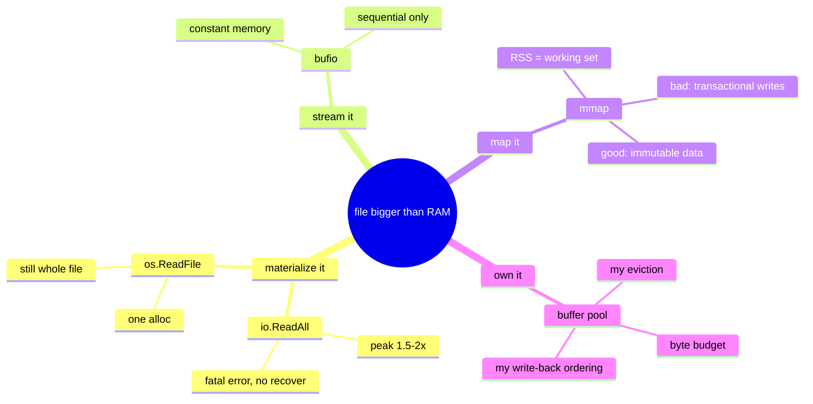

# Reading files in Go: where the bytes actually live

Source: side thread with Claude during S2, triggered by an `io.ReadAll` in one of the
eblog example programs (the small file-reading tools)
Date: 2026-07-22

Came up mid-read in S2 (eblog pt 1). Kept because it's the same decision a buffer pool
makes, at a smaller scale. Relevant to S16 (page replacement) and M6 (godb buffer pool).

## The question

`b, err := io.ReadAll(f)` — does this read the whole file into memory, or read some blocks
and fetch more as I loop over `b`?

**Whole file, eagerly.** Once `ReadAll` returns, every byte is on the heap. Ranging over
`b` is pure memory access — zero syscalls. The chunking happens *inside* `ReadAll`
(repeated `read(2)` until EOF, growing the slice), not lazily at use time.

## The four options

| Approach | Memory | Handles file > RAM? | Notes |
|---|---|---|---|
| `io.ReadAll` | whole file, **peak ~1.5–2×** | no | slice doubles as it grows: alloc new array, copy, free old |
| `os.ReadFile` | whole file, 1 alloc | **no** | `Stat`s first, sizes buffer once — perf fix, *not* a scale fix |
| `bufio.Scanner`/`Reader` | constant (~64KB) | yes | right answer for sequential processing |
| `mmap` | virtual only; RSS = working set | yes | right answer for random access into huge files |

The trap: `os.ReadFile` *feels* like the fix for `ReadAll` but solves a different problem.
It removes the copy churn, not the requirement to hold the whole file.

## What failure looks like (16GB file, 8GB RAM)

`ReadAll` growth needs a **contiguous** block, so going 8GB → 16GB allocates the new array
while the old one is still live: peak demand ~24GB.

- Linux, no swap: `fatal error: runtime: out of memory`, or OOM killer → SIGKILL, exit 137
- Linux, with swap: minutes of thrashing (looks like a hang) → OOM kill
- macOS: compressed memory → swap balloons → "out of application memory"

**This is a `fatal error`, not a `panic`.** No `recover()`, no error return. The
`if err != nil` line is never reached — the process is already dead.

So `io.ReadAll` on input whose size you don't control is a DoS vector (classic in HTTP
handlers reading request bodies). Defenses:

```go
b, err := io.ReadAll(io.LimitReader(r, 10<<20))   // cap it
if fi, _ := f.Stat(); fi.Size() > maxSize { ... }  // check first
sc := bufio.NewScanner(f); for sc.Scan() { ... }   // don't materialize at all
```

## Why mmap works — and why databases still avoid it

mmap changes *what you spend*: 16GB of virtual address space (you have 128TB on 64-bit),
physical RAM only for pages you touch. Kernel faults them in, evicts under pressure.

Every serious objection is about the **write path**:

- **Lost write ordering** — durability needs "WAL record on disk *before* the data page."
  The kernel flushes dirty pages when it likes; `msync` can't stop a background flush from
  beating your log. Breaks crash recovery at the foundation.
- **SIGBUS instead of `error`** — an I/O error kills the process where `read()` would have
  returned something handleable.
- **TLB shootdowns** — unmapping a page invalidates TLB entries on every core (IPI storm).
  Becomes the bottleneck on many-core boxes, and it isn't your code to tune.
- **No intelligent prefetch** — a DB knows it's about to scan pages 100–200; `madvise` is
  blunt compared to issuing your own async reads.

But mmap is genuinely good for **immutable, read-mostly** data — the write objections
evaporate. Lucene/Elasticsearch map segment files aggressively (segments are write-once).
LMDB is mmap end-to-end and rock solid, buying safety differently: copy-on-write B+tree,
single writer, no in-place page updates — paid for with write amplification and a hard
single-writer limit.

Data point: MongoDB's MMAPv1 engine was replaced by WiredTiger, which manages its own cache.



## Prefetch / read-ahead (why the buffer pool wins objection #4)

Once you own the buffer pool, you can read *neighbors* of page N ahead of time so the next
request is already a cache hit. But it's conditional — reading neighbors only pays when
you'll actually use them.

- **Sequential / scan access** (range scan, full table scan, large index range): pages
  N+1, N+2… are almost certainly next. The DB detects this and issues **one big sequential
  read** for a run of pages instead of N single-page `pread`s. Big win — sequential I/O is
  far cheaper than scattered random I/O (fewer syscalls; no per-page seek on HDD; bigger
  I/Os amortize overhead on SSD). Postgres does exactly this (and coordinates it across
  concurrent scans — `synchronize_seqscans`).
- **Random / point access** (PK lookup, root-to-leaf B-tree walk): neighbors of N have
  nothing to do with what's next. Prefetching here is a **trap** — you burn bandwidth on
  junk pages *and* they evict useful pages from the fixed-size pool. Cache pollution.

```
random point lookups     →  read exactly page N, nothing more
detected sequential scan →  read N, N+1, … N+k in ONE big I/O (read-ahead)
```

So the DB doesn't blindly grab neighbors — it **detects the access pattern** and prefetches
only when it looks sequential.

**This is objection #4 made concrete.** The kernel does read-ahead on mmap'd files too, but
it only sees "page fault at offset X" — it can't tell a B-tree point lookup from a table
scan, because it doesn't know it's a B-tree. The database *does* know (this query is a range
scan), so it prefetches intelligently where the kernel guesses. mmap throws that knowledge
away.

Two levels of "read neighbors" that are easy to conflate:
- *Prefetch* — read-ahead of pages you predict you'll ask for (the above).
- *Page size* — a page is already 8KB (not one row) because reading a bit of on-disk
  neighborhood is nearly free once you've paid for the seek. Prefetch is the same idea one
  level up: grab neighbor *pages* when the pattern predicts you'll want them.

## The connection to godb (M6)

`ReadAll`'s philosophy is *let the file decide how much memory you use*. A database can
never do that — the data file is routinely bigger than RAM. So it declares a byte budget
up front (say 64MB), reads fixed-size pages into it, and evicts.

For godb, build the buffer pool rather than mmap — not because mmap can't work, but
because the whole point of that milestone is **owning** the decisions mmap delegates to
the kernel: which page to evict, when a dirty page is safe to write back, how that orders
against the log. Same insourcing move as the LRU → buffer pool example in
`eblog-programs.md`.

## Pointer for M6

Crotty, Leis, Pavlo — *"Are You Sure You Want to Use MMAP in Your DBMS?"* (CIDR 2022).
The paper behind the case against. Read at the godb buffer pool milestone.
