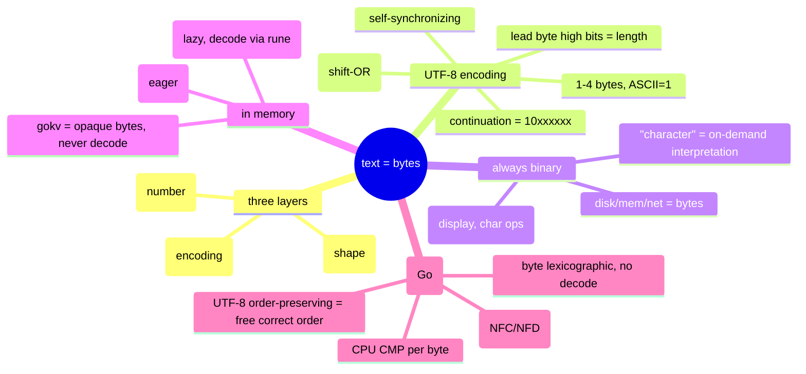

# Text encoding: Unicode, UTF-8, and bytes ↔ characters

Source: S3 side-thread with Claude (Oct 2026), sparked by `café`/`é` while building `shexdump`
Related: [[eblog-programs]], [[bytes-and-numbers]] (the concat step = the shift-OR from there)

Big reusable thread. The recurring lesson: **a "character" is never a stored thing — it's an
interpretation computed from bytes on demand. Storage/transport is always bytes.**

My own recap in my words (built from memory, gap-checked): [[text-encoding-my-summary]].

## The three layers (the core mental model)

Three *separate* jobs people lump together as "Unicode":

| layer | job | for `é` |
|---|---|---|
| **Unicode** | character ↔ **code point** (a number + identity/name). NOT glyphs, NOT bytes. | é = U+00E9 = 233 |
| **UTF-8** | **encoding**: code point ↔ bytes. One of several (UTF-16, UTF-32). | 233 → `c3 a9` |
| **Font** | code point → **glyph** (the drawn shape). Appearance only. | 233 → *é* |

Separation of concerns: swap any layer without disturbing the others — many fonts for one code
point (it stays U+00E9), convert UTF-8↔UTF-16 without changing characters. Same principle as
logical-vs-physical query plans (M8).

## Code point vs byte

- 1 byte = 8 bits = 0–255. **ASCII: 1 char = 1 byte** (code points 0–127).
- **UTF-8: a char is 1–4 bytes** — ASCII 1, Latin-accents/Greek/Cyrillic/Arabic 2, CJK 3, emoji 4.
- "1 char = 1 byte" is true *only* for ASCII.
- UTF-8 is a **superset of ASCII** (ASCII bytes unchanged) and variable-width to avoid bloat —
  vs fixed-width UTF-32 (always 4 bytes), UTF-8 is a space *saving* for common text. Its worst
  case (4 bytes) is UTF-32's every case. The 4-byte chars aren't "4× an ASCII char" — ASCII
  can't represent them at all.

## UTF-8 bit layout (self-describing)

```
1-byte: 0xxxxxxx
2-byte: 110xxxxx 10xxxxxx
3-byte: 1110xxxx 10xxxxxx 10xxxxxx
4-byte: 11110xxx 10xxxxxx 10xxxxxx 10xxxxxx
```
- **Leading byte's high bits encode the total byte count** (count the leading 1s). Continuation
  bytes are always `10xxxxxx`.
- **Self-synchronizing:** leading bytes never start `10`; continuation bytes always do — so you
  can tell "start of char" from "middle of char" at *any* byte.
- Decoder loop: read leading byte → length from its high bits → read N−1 continuations → repeat.
  No length field, no lookahead. Each char's first byte announces its own length.

## Worked decode: café's `é` = `c3 a9` → 233

```
c3 = 110 00011   strip "110" tag → data = 00011   (5 bits)
a9 =  10 101001  strip "10"  tag → data = 101001  (6 bits)
concat (lead high-order first): 00011 101001 = 00011101001 = 233 = 0xE9 = U+00E9 = é
```
Recipe: **bytes → binary → strip tags → concat data bits (lead first) → read the combined binary
as ONE number = the code point.**

**Why concat, not add:** the bits are *positional* — lead bits are high-order, continuation bits
low-order. Concatenation = shifting the lead into place: `(0b00011 << 6) | 0b101001` =
`192 | 41` = `233`. Just adding (`3 + 41 = 44`) throws away place value. This is the same
shift-OR as assembling an int from bytes in [[bytes-and-numbers]], with odd group sizes (5+6).
(Raw per-byte decimals `195`+`169` have no simple relation to `233` — you MUST go via binary.)

## Same bits, different meaning by layer (recurring theme)

- `0xFF`: as a **raw byte** = 255; as a **UTF-8 byte** = *invalid* (no valid sequence uses it).
- `0xC3`: raw byte = 195; UTF-8 = "2-byte lead".
- UTF-8 *reserves* the high-bit patterns for framing, so a single byte can't freely be any of 256
  values as a character — a 1-byte char is only 0–127. Char #255 `ÿ` = **2 bytes `c3 bf`**, NOT
  the single byte `0xFF`. The value 255 lives in the *data bits* of two framed bytes.
- **It never stops being binary.** Code points are ints (bits); glyphs are pixel data (bits).
  "Character" is an interpretation, not a physical form. Hex/decimal/binary are all human
  *notations* for the same bits; physically it's charge / voltage / magnetic orientation.

## Where text lives: always bytes

- **Disk, memory, network — always bytes (binary).** A packet carrying é carries `c3 a9`.
- Decoding (bytes → code points) is **transient, in-memory, on demand** — when a program needs
  character meaning: display, or char-level ops (length, index, search). Many ops **never decode**
  (copy, store, transmit, exact-match) — they treat text as **opaque bytes**.
- Display pipeline: `bytes ──UTF-8 decode──▶ code point ──(Unicode: identity)──▶ ──font──▶ glyph`.

## In-memory representation: Python vs Go (opposite choices)

- **Python `str` = code points** (fixed-width array; PEP 393 picks 1/2/4 bytes per char by the
  biggest code point). `"café"` = `[99,97,102,233]`, stored 1 byte each (max 233 ≤ 255) = bytes
  `63 61 66 e9`. **In memory é = `0xE9` (the code point), NOT `c3 a9`.** It *encodes* to UTF-8
  (`c3 a9`) only at the I/O boundary.
- **Go `string` = UTF-8 bytes directly.** `"café"` in memory = `63 61 66 c3 a9` (5 bytes); é =
  `c3 a9`. Memory form **=** disk/wire form (no encode step). Decode to code points on demand:
  `[]rune(s)` (an `int32` array) or `for _,r := range s`.
- Trade-off: **Python** eager-decodes (O(1) char indexing, clean char ops, must encode/decode at
  I/O, more memory). **Go** stays lazy (compact, zero-cost I/O, but O(n) to find the Nth *char*,
  and you must track bytes-vs-runes).
- **gokv = the Go model taken further:** stores keys/values as **raw opaque bytes**, never
  decodes. `c3 a9` in, `c3 a9` out — the character layer never enters the DB.

## Comparison in Go: byte-level, no decoding

- `==`: compare **length** first (fast reject), then the **bytes** (word-at-a-time under the
  hood). Identical bytes ⇔ equal. é matches é because `c3 a9` == `c3 a9` — 233 is never computed.
- `<`: **lexicographic by byte value** — compare byte 0; tie → next byte; first differing byte
  decides (smaller wins); if one is a prefix of the other, the shorter is less. (Like dictionary
  order, bytes instead of letters.) Comparison **ignores character boundaries** — it just marches
  bytes; Go doesn't know/care that `c3 a9` is "one character" during a compare.
- The per-byte compare is a **CPU instruction** (`CMP` — treats the byte as an unsigned 0–255 int,
  decided from the most-significant differing bit). Go only supplies the byte-by-byte loop. It's
  not "Go byte-order checking" — comparing two numbers is primitive hardware.
- **UTF-8 is order-preserving: byte order == code-point order**, so Go gets correct Unicode
  ordering *for free* from raw byte compare — no decoding. Two reasons:
  1. *Across lengths:* more leading 1s → bigger lead byte → sorts later (ASCII `0xxxxxxx` ≤127
     always sorts before multibyte leads `11xxxxxx` ≥192) — matches that ASCII code points < the
     rest. The length-framing bits do the ordering.
  2. *Within a length:* the data bits are packed big-endian, so byte order tracks value order.
  - `"a"`(61) < `"é"`(c3 a9): differ at byte 0, `97<195` → correct (97<233).
  - `"è"`(c3 a8) < `"é"`(c3 a9): byte 0 ties, `a8<a9` → correct (232<233).

## Normalization caveat ("1 char = 1 code point" is a simplification)

`é` can be **one** code point (U+00E9, `c3 a9`, precomposed) **or two** (`e` + combining acute
U+0301 = `65 cc 81`, decomposed). They look identical but have different code points AND different
bytes, so **both Go (bytes) and Python (code points) report them unequal.** Fix: **Unicode
normalization** (NFC collapses to precomposed, NFD expands to decomposed) before comparing.

## Why UTF-8 is a masterpiece (Thompson & Pike, 1992)

Three hard properties from one bit-layout choice:
- **ASCII-compatible** — old ASCII text is valid UTF-8 unchanged.
- **Self-synchronizing** — continuation bytes marked `10`, so boundaries are findable anywhere.
- **Order-preserving** — byte sort = code-point sort.


